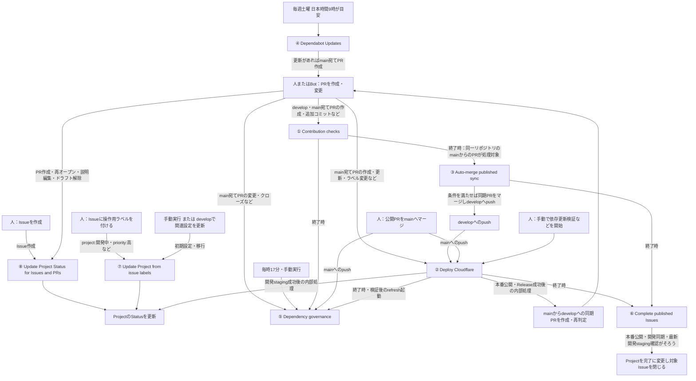
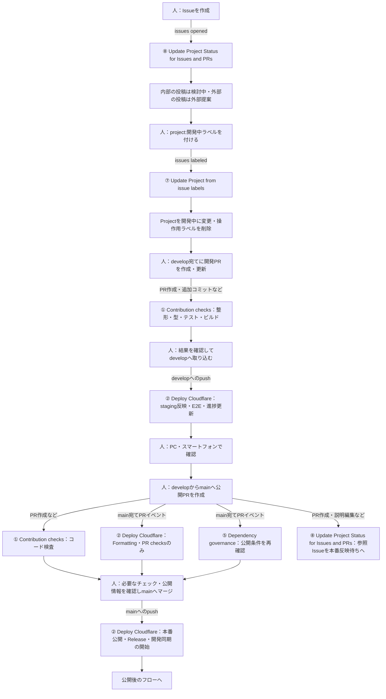
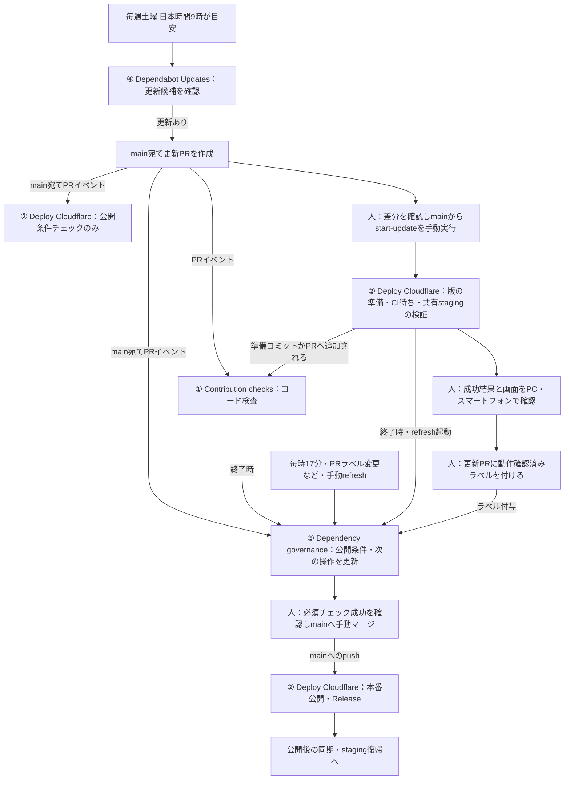
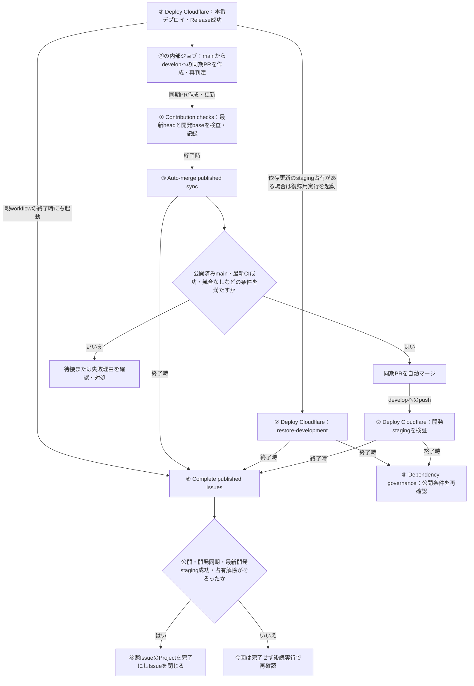
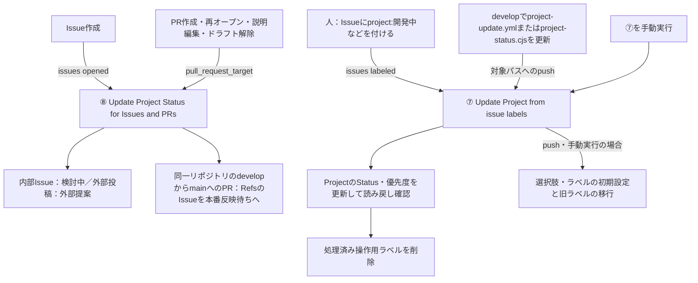

# GitHub Actionsの使い方と全体フロー

このガイドは、運用を担当する8つのActionsについて、**何をすると起動し、どの場面で何をするか**を説明します。
現在の開発ブランチは `develop`、本番ブランチは `main` です。
stagingは、本番公開前に画面と動作を確認する環境です。

## まず全体を見る：8つすべてのつながり

四角の先頭の①〜⑧が、Actions画面の8つの名前に対応します。
矢印の文字は起動のきっかけです。同じ出来事から複数のworkflowが並行して動きます。
「終了時」は成功・失敗の両方を含みます。起動後に条件を確認するため、**起動しただけで公開・マージ・完了するわけではありません**。

④はGitHub標準のDependabot機能で、設定は `.github/dependabot.yml` にあります。
ほかの7つは `.github/workflows/` のYAMLで定義されています。
⑤は公開条件を再評価する係です。⑤の成功だけでデプロイやmainへのマージを行うものではありません。
②の「同期PR作成」「進捗更新」は②の内部ジョブであり、別のworkflowではありません。

## 場面A：機能を開発して本番へ公開する

### 人が行うこと

1. Issueを作成し、着手時に `project:開発中` ラベルを付ける。
2. コードを検査し、developへの反映後にstagingを確認する。
3. 公開PR本文に対象Issueを独立した行で `Refs #123` と記載する。複数は `Refs #123, #124`。
4. [資材のバージョン管理](releases.md)に従い、`Release-Version: vMAJOR.MINOR.PATCH` と `### DB変更・復旧` を記載する。
5. 必須チェックを確認し、管理者が **Create a merge commit** でmainへマージする。developは削除しない。

main宛てPRで②が動いても、その実行は検査です。本番公開はmainへのマージによるpushがきっかけです。
⑤は通常の機能公開でも、未対応の依存更新や未同期mainなどの条件を確認します。

## 場面B：依存ライブラリを更新する

### 検証開始の操作

GitHubの **Actions → Deploy Cloudflare → Run workflow** で入力します。

| 入力       | 値                     |
| ---------- | ---------------------- |
| Branch     | `main`                 |
| action     | `start-update`         |
| pr         | 更新PR番号。例：`123`  |
| source_run | 通常の手動実行では空欄 |

成功後、PC・スマートフォンで確認して更新PRに **動作確認済み** ラベルを付けます。
`Formatting`・`PR checks`・`Contribution checks`・`Dependency release gate` の成功を確認し、人がmainへマージします。

更新PRのCI成功だけではstagingに反映しません。
更新検証中は共有stagingを占有するため、通常開発のデプロイが止まることがあります。
中止・失敗時は状態ブランチを編集せず、[依存更新の運用](dependency-updates.md)の復帰手順を使ってください。
セキュリティ更新は週次の通常更新とは別枠で扱われます。

## 場面C：公開後に開発へ同期し、Issueを完了する

通常開発と依存更新の両方が、このフローにつながります。

②の内部ジョブも同期PRの自動マージを再判定するため、すでにCI成功済みならそこで同期が進む場合があります。
同期が不要な場合もあります。開発stagingの検証には、条件を満たした既存の検証記録を再利用する場合があります。
③の終了直後は開発stagingがまだ処理中のことがあるため、⑥が一度起動してもIssueは閉じません。
**mainへのマージ済み表示は、公開後の処理がすべて終わったことを意味しません。**

## 場面D：Issue・Projectの進捗を更新する

⑧は出来事から自動判断し、⑦は人が付けた操作用ラベルを指示として処理します。
⑦のラベル処理には書き込み権限が必要です。無関係なラベルでは更新処理はスキップされます。
PRへのラベル付与は `issues:labeled` ではないため、⑦で外部PRのStatusを操作せず、Project画面で変更してください。

| 操作用ラベル                                               | Projectへの反映    |
| ---------------------------------------------------------- | ------------------ |
| `project:外部提案` / `project:検討中` / `project:開発待ち` | 同名のStatusへ変更 |
| `project:開発中` / `project:staging確認待ち`               | 同名のStatusへ変更 |
| `project:本番反映待ち` / `project:完了`                    | 同名のStatusへ変更 |
| `priority:高` / `priority:中` / `priority:低`              | 優先度を変更       |

⑦で `project:完了` を付ける操作はProjectのフィールド変更です。公開完了を検証してIssueを閉じる⑥とは処理が異なります。
デプロイ失敗時にラベルで状態だけを先へ進めないでください。

## 起動条件の早見表

PRの「更新」はイベントによって意味が異なります。追加コミットは `synchronize`、タイトル・本文などの編集は `edited` です。

| 番号・workflow                             | 自動起動の条件                                                                                                                                            | 手動実行                                                                 |
| ------------------------------------------ | --------------------------------------------------------------------------------------------------------------------------------------------------------- | ------------------------------------------------------------------------ |
| ① Contribution checks                      | develop・main宛てPRの `opened` / `synchronize` / `reopened` / `ready_for_review`                                                                          | Run workflowなし。既存実行の再実行は可能                                 |
| ② Deploy Cloudflare                        | develop・mainへのpush。main宛てPRの `opened` / `reopened` / `synchronize` / `edited` / `ready_for_review` / `labeled` / `unlabeled`                       | 可能。検証・復帰などは他の処理から自動で手動イベントを発行する場合もある |
| ③ Auto-merge published sync                | ①の終了。実処理は同一リポジトリのmainからのPRが対象                                                                                                       | mainから再確認可能                                                       |
| ④ Dependabot Updates                       | 毎週土曜9時（Asia/Tokyo）が目安。セキュリティ更新は別枠                                                                                                   | Dependabot画面のCheck for updates                                        |
| ⑤ Dependency governance                    | main宛てPRの `opened` / `synchronize` / `reopened` / `closed` / `edited` / `labeled` / `unlabeled` / `ready_for_review`。mainへのpush。①②の終了。毎時17分 | mainから実行                                                             |
| ⑥ Complete published Issues                | ②③の終了                                                                                                                                                  | 再確認可能                                                               |
| ⑦ Update Project from issue labels         | Issueへの対象ラベル付与。developで `.github/workflows/project-update.yml` または `scripts/project-status.cjs` を変更するpush                              | 初期設定・移行を実行                                                     |
| ⑧ Update Project Status for Issues and PRs | Issueの `opened`。PRの `opened` / `reopened` / `edited` / `ready_for_review`（宛先ブランチ制限なし）                                                      | Run workflowなし                                                         |

定期実行の時刻は予約上の目安で、GitHub側の混雑などにより遅れる場合があります。

## 手動実行の選び方

Actionsで対象workflowを選び、**Run workflow** からブランチと入力を指定します。
通常の開発はpushを使います。本番への手動デプロイ・再実行は管理者が意図して行ってください。

### ② Deploy Cloudflare

| action                | 使う場面                                                                              |
| --------------------- | ------------------------------------------------------------------------------------- |
| `start-update`        | mainから更新PR番号を指定。準備・CI待ち・staging検証をまとめて実行（手動実行の既定値） |
| `validate-update`     | 依存更新の再検証。復旧条件は依存更新ガイドを参照                                      |
| `abort-update`        | 更新検証を中止し開発用stagingへ戻す                                                   |
| `restore-development` | 開発用stagingの復帰・再試行                                                           |
| `development`         | developなら開発staging、mainなら本番デプロイ                                          |

**Branchをmain、actionをdevelopmentにすると本番の処理対象です。**

### ⑤ Dependency governance

mainから実行します。`refresh` 以外は管理者権限が必要です。

| action    | 使う場面・入力                                               |
| --------- | ------------------------------------------------------------ |
| `refresh` | 公開条件と次の操作を再確認する。通常の再確認はこれを使う     |
| `setup`   | 導入時の設定。前提権限と確認項目は依存更新ガイドを参照       |
| `prepare` | `pr` を指定し更新の版などを準備。通常は②のstart-updateを使う |
| `defer`   | `pr` と `reason` を指定し、理由付きで30日間延期              |
| `undefer` | `pr` を指定し延期を解除                                      |
| `sync`    | 公開済みmainの開発同期と自動マージ条件を再判定               |
| `cleanup` | 公開済みの条件を満たすマージ済みDependabotブランチを整理     |

## 結果の見方・困ったとき

Actionsの対象実行を開き、**Summary → 各ジョブ → 失敗したステップのログ**を確認します。
成功はその実行が正常に終わったことを示します。待機・対象外でも成功やスキップになる場合があり、次の操作はSummaryとPRの案内で確認します。

| 状況                                        | 確認・操作                                                                                 |
| ------------------------------------------- | ------------------------------------------------------------------------------------------ |
| PRの検査が赤い                              | ①の失敗ログを確認し、修正をpush                                                            |
| staging・本番に反映されない                 | ②のDeployと占有・公開条件の案内を確認                                                      |
| PR checksは緑なのに依存更新をマージできない | ⑤が更新するDependency release gateと次の操作を確認                                         |
| 公開済み変更がdevelopに戻らない             | 同期PRの①、③のSummaryを確認。競合・開発base変更などは開発側で対処                          |
| 公開後もIssueが開いている                   | PRのRefs、Release、開発同期、最新開発staging、⑥の待機理由を確認。解決後は⑥を手動再確認可能 |
| 操作用ラベルが消えた                        | ⑦の正常処理。Project側の更新結果を確認                                                     |
| 本番Deploy成功・Release作成だけ失敗         | 原因解消後、失敗ジョブのみ再実行。本番再デプロイは不要                                     |

## 定義と詳しい運用手順

- [Contribution checks](../.github/workflows/contribution-checks.yml)
- [Deploy Cloudflare](../.github/workflows/cloudflare.yml)
- [Auto-merge published sync](../.github/workflows/published-sync.yml)
- [Dependabotの設定](../.github/dependabot.yml)
- [Dependency governance](../.github/workflows/dependency-governance.yml)
- [Complete published Issues](../.github/workflows/release-completion.yml)
- [Update Project from issue labels](../.github/workflows/project-update.yml)
- [Update Project Status for Issues and PRs](../.github/workflows/issue-status.yml)
- [依存更新の運用](dependency-updates.md)
- [Issueの状態管理](issue-status.md)
- [資材のバージョン管理](releases.md)
- [staging検証の再利用](staging-validation-reuse.md)
- [Cloudflare設定と公開手順](../CLOUDFLARE-MIGRATION.md)

## 状況表示専用：Track dependency progress

運用を担当する上記8つに加え、依存更新PRの案内コメントを更新する専用workflow。
PR更新・検証や公開処理の開始と終了・5分ごとの定期実行で、最新のPRと実行結果を読み直す。
デプロイの順番待ちとは別に動き、待機理由・次の操作・実行リンク・マージ後の公開とstaging復帰を表示する。
この処理自体はデプロイ、公開条件の緩和、確認済み記録の作成を行わない。
main反映後に有効になり、GitHubの実行待ちにより更新が遅れる場合がある。
